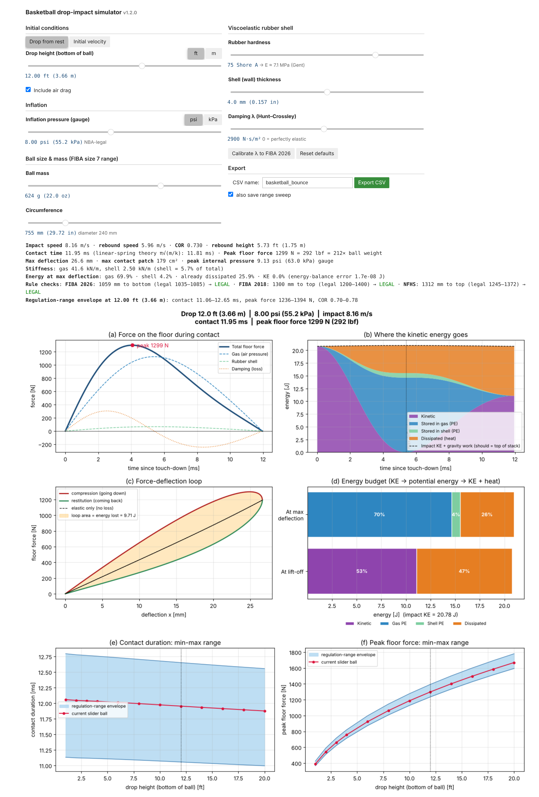

# Basketball Drop-Impact Simulator


**Author:** Tico Hannan ·
**Screenshots and docs:** <https://ticohannan.github.io/basketball-bounce-sim/>

This tool is an interactive Jupyter notebook. It predicts the **force a floor feels** when a
basketball is dropped on it, **how long the ball stays in contact**, and **how the ball's
kinetic energy is converted** into stored (potential) energy and heat during the bounce.

You can adjust the drop height (ft or m) and the inflation pressure (psi or kPa) with
sliders. Instead of a simple drop, the ball can also start with an **initial velocity**:
positive is upward, negative is thrown downward, in m/s or ft/s. You can also adjust the viscoelastic shell properties: rubber hardness, wall
thickness and damping. Every slider covers a range taken from published rules and data, and
the plots redraw when you release a slider. Results can be exported to CSV.



## Quick start

1. Install Python 3.10+ with the SciPy stack. [WinPython](https://winpython.github.io/)
   3.12 already includes everything; otherwise run:

   ```bash
   pip install -r requirements.txt
   ```

2. Open **`basketball_bounce_sim.ipynb`** in Jupyter (Notebook or Lab) and run the cell.
   The panel appears below it. Other ways to start it:

   * Paste the whole of `basketball_bounce_sim.py` into one notebook cell and run it.
   * Type `%run basketball_bounce_sim.py` in a cell.
   * Use `from basketball_bounce_sim import launch; launch()`.

3. Move the sliders. Click **Export CSV** to save the bounce time history, plus an
   optional min/max sweep table, next to the notebook.

You can also use it without the GUI:

```python
from basketball_bounce_sim import default_params, simulate_drop
p = default_params()
p["drop_height_ft"] = 12
p["pressure_psi"] = 8.0
p["v_init_m_s"] = 0.0                  # optional starting velocity, + up / - down
res = simulate_drop(p)                 # damping auto-calibrated to FIBA 2026
print(res["contact_time_ms"], res["peak_force_N"], res["COR"])
res["timeseries"].head()               # pandas DataFrame
```

Running `python basketball_bounce_sim.py` from a terminal prints a summary and saves
`bounce.png` and `sweep.png`.

## What it shows

**Plots:**

* **(a)** Floor force vs time, split into its parts: gas spring, rubber shell and damping.
* **(b)** Stacked energy vs time: kinetic energy → stored gas and shell energy → kinetic
  energy + heat.
* **(c)** Force–deflection hysteresis loop. The area inside the loop is the energy lost.
* **(d)** Energy budget at maximum deflection and at lift-off.
* **(e, f)** Min–max envelope of contact time and peak force vs drop height, for all
  regulation-plausible balls.

**Readouts:**

* COR and rebound height
* Peak force in N, lbf and multiples of the ball's weight
* Maximum squash and contact-patch size
* Peak internal pressure
* Pass/fail in the FIBA 2026, FIBA 2018 and NFHS rebound tests
* With an initial velocity: the apex height (for an upward throw) and the
  **equivalent drop height**, i.e. the drop from rest that would hit the floor at the
  same speed

**Example (12 ft drop, 8 psi, FIBA-legal damping):**

* Contact time ≈ 12.0 ms
* Peak floor force ≈ 1300 N (≈ 290 lbf)
* At maximum squash, 70 % of the impact energy is stored in the compressed air, 4 % in
  the rubber, and 26 % has already been lost as heat
* Range across regulation balls: contact 11.1–12.7 ms, peak force 1240–1390 N

## The model in one paragraph

The ball is a lumped mass on a nonlinear spring–damper.

* **Spring:** the pressurised air pushing on the flat contact patch,
  *F*<sub>gas</sub> = (*P* − *P*<sub>atm</sub>)·*A*(*x*). The air is compressed
  adiabatically as the ball's volume shrinks [5], [6].
* **Shell:** a thin-shell bending stiffness is added for the rubber [7], with its modulus
  taken from Shore A hardness through Gent's relation [8].
* **Damping:** losses use the Hunt–Crossley form λ·*x*·*ẋ* [9]. λ is calibrated so the ball
  passes the official FIBA rebound test [2].
* **Flight:** before impact the ball falls (or is first thrown up, then falls) under
  gravity and quadratic air drag. Exact closed-form solutions give the impact speed.
* **Motion:** *m ẍ* = *mg* − *F*, integrated from touch-down to lift-off with an adaptive
  Runge–Kutta solver [17], [18].

Full equations, assumptions and verification are in **[docs/DESIGN.md](docs/DESIGN.md)**.

## Key assumptions

* The floor is rigid. A sprung wood floor would give longer contact and a lower peak force.
* The ball is a lumped mass; shell vibration and the momentum flux of shell mass landing on
  the floor are ignored.
* Gas compression is adiabatic and reversible.
* All energy losses are lumped into one calibrated damping constant.
* The impact is vertical, with no spin or friction. An initial velocity is vertical only.

## Repository layout

```
basketball_bounce_sim.py      single-file model + GUI (source of truth)
basketball_bounce_sim.ipynb   generated notebook (python tools/build_notebook.py)
requirements.txt
tests/test_physics.py         verification tests (python -m pytest -q)
examples/                     sample CSV output for a 12 ft drop
docs/
  DESIGN.md                   design document: equations, assumptions, V&V
  REFERENCES.md               ASME-format references with DOIs/ISBNs/URLs
  USER_GUIDE_PLAN.md          plan for the user guide
  index.md                    GitHub Pages landing page
  images/                     screenshots and example figures
CHANGELOG.md  CITATION.cff  LICENSE
```

## References (abbreviated; full ASME list in [docs/REFERENCES.md](docs/REFERENCES.md))

1. NBA Official Rulebook 2026–27, Rule No. 1 — ball pressure 7.5–8.5 psi.
2. FIBA, *Official Basketball Rules 2026 – Basketball Equipment*, v1.0 — size-7 ball and rebound test.
3. FIBA, *Official Basketball Rules 2018 – Basketball Equipment*.
4. NFHS, *2026–27 Basketball Rules Book*, Rule 1-12-2.
5. Tadrist & Darbois Texier, 2017, arXiv:1708.01282, https://doi.org/10.48550/arXiv.1708.01282
6. Stronge & Ashcroft, 2007, Int. J. Impact Eng. 34(6), https://doi.org/10.1016/j.ijimpeng.2006.04.006
7. Lazarus, Florijn & Reis, 2012, Phys. Rev. Lett. 109, https://doi.org/10.1103/PhysRevLett.109.144301
8. Gent, 1958, Rubber Chem. Technol. 31(4), https://doi.org/10.5254/1.3542351
9. Hunt & Crossley, 1975, ASME J. Appl. Mech. 42(2), https://doi.org/10.1115/1.3423596
10. Cross, 1999, Am. J. Phys. 67(3), https://doi.org/10.1119/1.19229

…and others: [11]–[21], covering contact-time data, ball construction patents, drag and numerical methods.

## Versioning

The project follows [Semantic Versioning](https://semver.org/). The current version is in
`__version__` and is printed in the panel title and in every exported CSV. See
[CHANGELOG.md](CHANGELOG.md).

## How to cite

See [CITATION.cff](CITATION.cff). GitHub shows a "Cite this repository" button once the
repository is public.

## Acknowledgement of AI assistance

This software and its documentation were developed with the assistance of an AI assistant
(Anthropic Claude), under the direction and review of the author. The physics, data and
references were checked against the cited sources.

## License

BSD 3-Clause License. Copyright (c) 2026, Tico Hannan. See [LICENSE](LICENSE).
