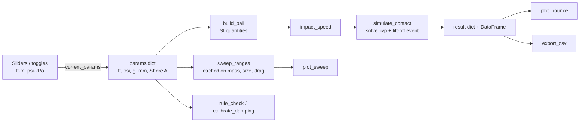

# Design Document — Basketball Drop-Impact Simulator

| | |
|---|---|
| **Document version** | 1.2.0 (matches software version `__version__ = "1.2.0"`) |
| **Author** | Tico Hannan |
| **License** | BSD-3-Clause |
| **Date** | 2026-10-20 |
| **Status** | Released |
| **Source file** | `basketball_bounce_sim.py` (single module, Sections 0–12) |

Numbers in square brackets, e.g. [5], refer to [`REFERENCES.md`](REFERENCES.md).

---

## 1. Purpose and scope

The tool predicts what a floor experiences when a basketball is dropped onto it:

* **Contact duration**: how long the ball touches the floor.
* **Peak floor force**: the largest force the floor feels.
* **Energy conversion**: how the ball's kinetic energy turns into stored potential energy
  at maximum deflection, and how much is lost as heat before the rebound.

The user can vary the drop height, the inflation pressure and the viscoelastic shell
properties within published ranges. The tool also reports the **minimum and maximum**
contact duration and peak force across regulation-plausible balls.

**Audience:**

* Undergraduate engineering and physics students.
* Instructors using it as a teaching or lab companion.

The code is deliberately written as one heavily commented file so that a student can read it
top to bottom.

**Out of scope:**

* Oblique impacts and spin.
* Compliant or sprung floors (an extension point, see §10).
* Finite-element shell mechanics.
* Acoustic emission.

## 2. Requirements

| ID | Requirement | Where implemented |
|---|---|---|
| R1 | The drop height can be varied (default 12 ft) and shown in **ft or m** | `launch()` height slider + unit toggle |
| R2 | The inflation pressure can be varied within published limits and shown in **psi or kPa** | `RANGES["pressure_psi"]`, unit toggle |
| R3 | The viscoelastic properties (rubber hardness, wall thickness, damping) can be varied within published ranges | `RANGES`, damping slider, `calibrate_damping()` |
| R4 | Report min/max contact duration over the plausible parameter range | `sweep_ranges()`, plots (e)–(f) |
| R5 | Show how kinetic energy becomes potential energy at maximum deflection | Energy bookkeeping, plots (b) and (d) |
| R6 | Report the peak force on the floor | `simulate_contact()`, plot (a) |
| R7 | Sliders re-plot the figures automatically | ipywidgets observers |
| R8 | The current slider values stay readable in a narrow window | The value is printed **below** each slider; the columns wrap |
| R9 | Export results to CSV | `export_csv()` |
| R10 | Thoroughly commented source code for undergraduates | Whole module |
| R11 | Runs in a Jupyter cell on Windows (WinPython 3.12) | Standard-library + SciPy-stack imports only; Windows-safe CSV writing |
| R12 | Sources for all data and equations | Header of the code, this document, `REFERENCES.md` |
| R13 | Versioned releases | `__version__`, `CHANGELOG.md`, git tags |
| R14 | Initial condition can be a drop from rest **or** a starting velocity (+ up / − down) in **m/s or ft/s** | `impact_speed(h, ball, v_init)`, mode toggle + velocity slider |

## 3. Architecture

A single Python module, split into numbered sections so that students can find things:

| Section | Contents | Key public functions |
|---|---|---|
| 0 | Header: how to run, the physical picture, sources, limitations | — |
| 1 | Imports, `__version__` | — |
| 2 | Physical constants and unit conversions | `G`, `P_ATM`, `PSI_TO_PA`, `KPA_PER_PSI`, … |
| 3 | Published parameter ranges, rule-test definitions | `RANGES`, `RULE_TESTS`, `default_params()` |
| 4 | Ball physics: geometry, gas, shell, damping | `ball_volume`, `contact_area`, `gas_force`, `gas_energy`, `shell_stiffness`, `shore_A_to_youngs_modulus`, `floor_force_parts`, `build_ball` |
| 5 | Flight phases with air drag | `impact_speed`, `rebound_height` |
| 6 | Contact simulation (ODE) | `simulate_contact`, `simulate_drop` |
| 7 | Rule tests and damping calibration | `rule_test_rebound`, `calibrate_damping`, `rule_check` |
| 8 | Min/max range sweep | `sweep_ranges`, `sweep_current_ball` |
| 9 | Plotting | `plot_bounce`, `plot_sweep` |
| 10 | CSV export | `export_csv` |
| 11 | Interactive panel (ipywidgets) | `launch` |
| 12 | Entry point (notebook → panel; terminal → PNGs + table) | — |

**Data flow:**

**Design decisions:**

* **Canonical units at the edges.**
  * The `params` dict always holds drop height in **ft** and pressure in **psi** (the keys
    of `RANGES`), whatever the GUI displays.
  * `build_ball()` converts everything to SI, and all physics runs in SI.
  * The GUI converts the display units back to the canonical ones in `height_ft()` and
    `pressure_psi()`.
  * Result: a unit toggle can never change the physics.
* **Physics separated from the GUI.** Every physics function works without ipywidgets, so
  the model can be scripted, tested with pytest, or reused in other notebooks.
* **The notebook is generated from the `.py` file.** `tools/build_notebook.py` embeds the
  module in a single notebook cell. This keeps one source of truth while meeting R11.
* **Caching.**
  * The regulation sweep (16 corners × 12 heights = 192 ODE solves, about 1–2 s) depends
    only on mass, size and the drag switch, so it is recomputed only when those change.
  * Moving the pressure, hardness or damping sliders redraws in well under a second.

## 4. Physical model

### 4.1 Coordinates and sign convention

*x*(t) is the downward displacement of the ball's centre after first contact. It is called
the *deflection* or *indentation*.

* *x* = 0 at touch-down and again at lift-off.
* *ẋ* > 0 while the ball compresses and *ẋ* < 0 while it rebounds.

The drop (start) height *h* is measured from the floor to the **underside** of the ball,
the same convention the FIBA and NFHS rebound tests use [2]–[4]. The optional starting
velocity $v_i$ is vertical, **positive upward**. $v_i = 0$ is a simple drop.

### 4.2 Free fall and rebound (Section 5)

With quadratic air drag $F_D = \tfrac12 \rho C_D \pi R^2 v^2$ and terminal speed

$$
v_t = \sqrt{\frac{2 m g}{\rho\, C_D\, \pi R^2}},
$$

two exact results for quadratic drag are used.

**Rising.** A ball moving upward at speed *v* climbs a further

$$
h_{\text{up}}(v) = \frac{v_t^2}{2g}\,\ln\!\left(1 + \frac{v^2}{v_t^2}\right).
$$

**Falling.** For a falling ball, $d(v^2)/dy = 2g\,(1 - v^2/v_t^2)$. A ball that falls a
distance *H* starting with downward speed $v_s$ therefore reaches

$$
v_0^2 = v_t^2 + \left(v_s^2 - v_t^2\right) e^{-2 g H / v_t^2}.
$$

**Initial conditions.**

* If $v_i > 0$ (thrown upward), the ball first rises to an apex $h + h_{\text{up}}(v_i)$,
  then falls from rest: $H = h + h_{\text{up}}(v_i)$, $v_s = 0$.
* If $v_i \le 0$, it falls through $H = h$ with $v_s = |v_i|$. A ball thrown down faster
  than $v_t$ slows toward $v_t$.
* The same $h_{\text{up}}$ formula gives the rebound height after lift-off.

With the drag switch off, these reduce to $v_0 = \sqrt{v_i^2 + 2gh}$, whatever the
direction of $v_i$, and $h_{\text{up}} = v^2/2g$.

**Equivalent drop height.** The panel also reports the drop height from rest that gives the
same impact speed. It is found with Brent's method [19]. With drag, it does not exist if
$v_0 \ge v_t$.

* Values used: $\rho = 1.20$ kg/m³ and $C_D = 0.47$ (smooth sphere, subcritical
  Reynolds number [16]).
* For a 12 ft drop, drag lowers the impact speed by about 4 %.

### 4.3 Contact geometry (Section 4)

High-speed video shows that an inflated ball keeps its spherical shape and simply flattens
where it meets the floor [5], [6]. For a flattening depth *x*:

$$
V(x) = \frac{\pi}{3}\left(4R^3 + x^3 - 3 R x^2\right), \qquad
A(x) = \pi\left(2 R x - x^2\right) = 2\pi R x\left(1 - \frac{x}{2R}\right).
$$

Note that $dV/dx = -A(x)$. This identity is checked in the tests.

### 4.4 Gas spring

The bounce lasts about 10 ms, far too short for heat to cross the shell, so the air is
compressed **adiabatically** [5]:

$$
P_{\text{abs}}(x) = \left(P_{g,0} + P_{\text{atm}}\right)\left(\frac{V_0}{V(x)}\right)^{\gamma},
\qquad \gamma = 1.4 .
$$

Only the gauge pressure (inside minus outside) produces a net force on the contact patch:

$$
F_{\text{gas}}(x) = \left(P_{\text{abs}}(x) - P_{\text{atm}}\right) A(x).
$$

The elastic energy stored in the gas is the work done on it by the floor. That equals the
rise in the air's internal energy minus the work done by the surrounding atmosphere on the
shrinking ball:

$$
E_{\text{gas}}(x) = \frac{P_{\text{abs},0} V_0}{\gamma - 1}\left[\left(\frac{V_0}{V}\right)^{\gamma-1} - 1\right] - P_{\text{atm}}\left(V_0 - V\right)
= \int_0^x F_{\text{gas}}\,dx .
$$

For small *x* the ball behaves as a linear spring with
$k_{\text{gas}} = dF_{\text{gas}}/dx|_{0} = 2\pi R P_{g,0}$. This is about 41.6 kN/m at
8 psi.

### 4.5 Shell stiffness

The rubber shell's indentation stiffness is that of a thin elastic spherical shell [7]
(as written in [5], eq. 2.13):

$$
k_{\text{shell}} = \frac{4 E t^2}{R\sqrt{3(1-\nu^2)}}, \qquad F_{\text{shell}} = k_{\text{shell}}\, x,
\qquad E_{\text{shell}} = \tfrac12 k_{\text{shell}} x^2 .
$$

Here $\nu = 0.5$ (rubber is nearly incompressible). [5] used $\nu = 0$; the difference is a
factor of 1.15 on a term that is already small. The Young's modulus comes from the
measurable Shore A hardness *S* through Gent's relation [8]:

$$
E\,[\text{MPa}] = \frac{0.0981\,(56 + 7.62336\,S)}{0.137505\,(254 - 2.54\,S)} .
$$

For the default ball, $k_{\text{shell}} \approx 2.5$ kN/m, about 6 % of the total
stiffness. This agrees with the "storage number" analysis of [5]: in large inflated balls
the **gas** stores almost all the elastic energy.

### 4.6 Viscoelastic damping

Energy losses come from rubber hysteresis, seams and layers, air motion and sound. They are
lumped into a single Hunt–Crossley damping force [9]:

$$
F_{\text{damp}} = \lambda\, x\, \dot x .
$$

Why this form rather than a linear dashpot $c\dot x$:

1. It is zero at touch-down and lift-off (*x* = 0), so the floor never has to *pull* on the
   ball. A linear dashpot predicts a sticking (tensile) force at separation [9].
2. It makes the COR fall as impact speed rises, which matches observations [9], [11].
3. With a constant λ, a stiffer (more inflated) ball dissipates proportionally less energy,
   so its COR rises. This matches the experiments in [13].

The rules specify a rebound test rather than a damping value. So λ is **calibrated**
(§4.9), and the slider then lets students explore around that value.

### 4.7 Equation of motion and floor force

$$
m\,\ddot x = m g - F(x,\dot x), \qquad
F(x,\dot x) = \max\!\left(0,\; F_{\text{gas}} + F_{\text{shell}} + F_{\text{damp}}\right).
$$

* By Newton's third law, *F* is exactly the force the floor feels.
* Contact ends when *x* returns to 0 with *ẋ* < 0 (event detection).
* The contact duration $t_c$ is the time of that event.
* The coefficient of restitution is $e = v_{\text{out}}/v_0$.

**Linear-spring check.** For small deflections ($k = k_{\text{gas}} + k_{\text{shell}}$,
$\omega = \sqrt{k/m}$, no damping), the exact contact time is

$$
t_c = \frac{\pi + 2\arctan\!\left(g/(v_0\omega)\right)}{\omega} \;\xrightarrow{\;g \ll v_0\omega\;}\; \pi\sqrt{\frac{m}{k}} = \sqrt{\frac{\pi m}{2 R P_{g,0}}}\ \ (\text{shell neglected}),
$$

which is eq. 2.12 of [5]. The panel shows $\pi\sqrt{m/k}$ next to the simulated value.

### 4.8 Energy bookkeeping

A third ODE state integrates the dissipated power,
$\dot E_{\text{diss}} = (F - F_{\text{gas}} - F_{\text{shell}})\,\dot x$, so that at every
instant

$$
\underbrace{\tfrac12 m v_0^2}_{\text{impact KE}} + \underbrace{m g x}_{\text{gravity work}}
= \underbrace{\tfrac12 m \dot x^2}_{\text{KE}} + E_{\text{gas}}(x) + E_{\text{shell}}(x) + E_{\text{diss}}(t).
$$

* At maximum deflection, KE = 0. The plots show what fraction of the incoming energy is
  then stored (gas + shell) and what fraction has already been lost.
* The residual of this identity is reported as `energy_balance_error_J`. It is typically
  about 10⁻⁸ J.

### 4.9 Rule tests and damping calibration (Section 7)

| Test | Drop (underside) | Legal rebound | Measured to | Implied COR, no drag |
|---|---|---|---|---|
| FIBA 2026 [2] (**default**) | 1800 mm | 1035–1085 mm | underside | 0.758–0.776 |
| FIBA 2018 [3] (legacy) | 1800 mm | 1200–1400 mm | top of ball | ≈ 0.73–0.80 |
| NFHS [4] | 6 ft | 49–54 in | top of ball | ≈ 0.74–0.79 |

`calibrate_damping()` uses Brent's method [19] to find the λ for which the simulated
FIBA 2026 test rebounds to a chosen point in the legal band (default: the middle). For the
default ball, λ ≈ 2900 N·s/m².

> **Note.** [5] quotes "basketball COR = 0.816–0.882". That range comes from
> $\sqrt{1200/1800}$ to $\sqrt{1400/1800}$ and ignores the fact that the 2018 rule measures
> the rebound to the *top* of the ball. Subtracting the ball diameter gives roughly
> 0.73–0.80.

### 4.10 Regulation-range sweep (Section 8)

Every corner of this parameter box is simulated (2⁴ = 16 balls) at 12 drop heights from 1 to
20 ft:

| Parameter | Low | High | Source |
|---|---|---|---|
| Pressure | 7.5 psi | 8.5 psi | [1] |
| Shore A | 45 | 85 | [14] |
| Wall thickness | 2.5 mm | 5.0 mm | [5], [15] |
| Damping λ | liveliest legal | deadest legal | FIBA 2026 band [2], calibrated at 8 psi |

The minimum and maximum of contact time, peak force and COR at each height form the shaded
envelope in plots (e) and (f).

* Mass, circumference, the drag setting and the starting velocity come from the sliders.
  The x-axis is the start height.
* Each output is monotonic in each parameter, so the corners bracket the box.

## 5. Parameter ranges

| Slider | Range | Default | Basis |
|---|---|---|---|
| Drop height | 0.5–20 ft (0.15–6.10 m) | 12 ft | User choice; rule tests use 6 ft / 1.8 m |
| Inflation (gauge) | 5–12 psi (34.5–82.7 kPa) | 8.0 psi | NBA legal 7.5–8.5 psi [1]; wider so students can see under- and over-inflation |
| Mass | 567–650 g | 624 g (22 oz) | FIBA 2018 [3]; FIBA 2026 narrowed this to 580–620 g [2] |
| Circumference | 749–780 mm | 755 mm | FIBA 2018 [3]; FIBA 2026: 750–770 mm [2] |
| Rubber hardness | 45–85 Shore A | 75 | Cover rubbers [14] |
| Shell thickness | 2.0–6.0 mm | 4.0 mm | 2.5 mm [5]; layer stack ≈ 4–5 mm [15] |
| Damping λ | 0–6000 N·s/m² | calibrated (≈ 2900) | FIBA 2026 rebound band [2] |
| Starting velocity (+ up) | −15 to +15 m/s (±49 ft/s) | 0 (drop from rest) | Covers dribbles and throws. It keeps the impact speed ≲ 20 m/s, so the maximum squash stays below 2R/3, where the spherical-cap shape still holds [5]. |

## 6. Assumptions and limitations

| # | Assumption | Effect / justification |
|---|---|---|
| A1 | Rigid, flat floor | A sprung hardwood floor would lengthen contact and lower the peak force. Cross's ≈ 15 ms on a wood floor [11], versus ≈ 11 ms on marble [5], is consistent with this. |
| A2 | Lumped-mass ball; shell inertia and the "momentum flux" of shell mass landing on the floor [6] are neglected | Small for *x* ≪ 2R. At 12 ft, *x*/2R ≈ 0.11. |
| A3 | Adiabatic, reversible ideal-gas compression | Heat transfer during contact is estimated to be negligible [5] |
| A4 | Shell stiffness added in parallel to the gas spring | An approximation; the fully coupled pressurised-shell result is in [7] |
| A5 | One damping constant λ for all losses | The dominant loss mechanism in inflated balls is still debated [5]. λ is calibrated to the rule test, not derived. |
| A6 | Gent's hardness–modulus relation applied to a composite (rubber + windings + cover) | Indicative only; the shell term is small anyway (§4.5) |
| A7 | Purely vertical impact; no spin or friction | Friction does no work in a normal impact [5] |
| A8 | Constant *C*D = 0.47 during flight | Affects impact speed by only a few percent |
| A9 | The starting velocity is purely vertical, with no spin | An oblique throw would need tangential contact mechanics [6] |

## 7. Verification and validation

**Verification** (does the code solve the equations correctly?) is automated in
`tests/test_physics.py`. Run it with `python -m pytest -q`.

| Test | Checks |
|---|---|
| `test_geometry_limits` | $V(0) = \tfrac43\pi R^3$, $A(0) = 0$, $dV/dx = -A$ |
| `test_gas_energy_is_integral_of_gas_force` | The closed-form $E_{\text{gas}}$ equals $\int F_{\text{gas}}\,dx$ |
| `test_energy_balance` | The energy identity of §4.8 holds to better than 10⁻⁶ J |
| `test_elastic_ball_has_cor_one` | With λ = 0 and no drag, COR = 1 |
| `test_small_drop_matches_linear_spring_theory` | Matches the exact linear-spring contact time, including gravity, to 1 % |
| `test_higher_pressure_shorter_contact_and_higher_force` | Trends match [13] |
| `test_calibration_hits_rule_band` | The calibrated ball passes all three rule tests |
| `test_floor_never_pulls` | $F \ge 0$ even with large damping |
| `test_csv_round_trip` | The CSV re-reads correctly and carries the version tag |
| `test_no_drag_impact_speed_is_energy_conservation` | $v_0 = \sqrt{v_i^2 + 2gh}$ for up and down throws |
| `test_drag_upward_throw_equals_drop_from_apex` | An upward throw equals a drop from rest at its apex |
| `test_drag_down_throw_faster_than_drop_and_bounded_by_terminal_speed` | Downward throws hit harder; a ball thrown faster than $v_t$ slows toward $v_t$ |
| `test_drag_makes_up_throw_slower_than_down_throw` | Drag acts on the longer upward path |
| `test_simulate_drop_with_initial_velocity_energy_and_metadata` | The energy balance holds and the CSV records $v_i$ |

**Validation** (does the model match reality?):

| Quantity | Model (default ball) | Literature |
|---|---|---|
| Contact time | 11.1–12.8 ms (regulation range) | ≈ 11 ms on a rigid surface [5]; ≈ 15 ms on a wood floor [11] |
| COR at the FIBA test speed | 0.76–0.78 (calibrated) | 0.78 measured [5] |
| Force pulse shape | Near half-sine, peaking slightly before maximum deflection | "Varies in a sinusoidal manner" [12] |
| Contact time vs speed | Falls slightly as height rises | Same trend [11] |

## 8. Numerical methods

* **ODE solver:** `scipy.integrate.solve_ivp` [17] with RK45 (Dormand–Prince 5(4) [18]).
  * Tolerances: `rtol = 1e-9`, `atol = [1e-12, 1e-10, 1e-12]`.
  * A dense output is sampled at 600 evenly spaced points.
* **Lift-off detection:** terminal event on *x* = 0 with direction −1.
* **Calibration:** `scipy.optimize.brentq` [19] on λ ∈ [0, 50 000] N·s/m², with
  `xtol` = 1 N·s/m².
* **Cost:** about 4 ms per contact solve. One slider update (one bounce + 12-height curve +
  3 rule tests) takes about 0.1 s. A sweep recompute takes about 1–2 s.

## 9. Outputs

**Panel:**

* Readouts:
  * with an initial velocity: the start condition, the apex height and the equivalent
    drop height
  * impact and rebound speed, COR, rebound height
  * contact time (simulated and from linear theory)
  * peak force (N, lbf, × ball weight)
  * maximum deflection, maximum contact-patch area, peak internal pressure
  * stiffness split between gas and shell
  * energy split at maximum deflection
  * rule-test verdicts
  * the regulation envelope at the current height
* Plots:
  * (a) force components vs time
  * (b) energy vs time (stacked)
  * (c) force–deflection hysteresis loop; its area is the energy lost
  * (d) energy budget at maximum deflection and at lift-off
  * (e) contact-time envelope vs height
  * (f) peak-force envelope vs height

**CSV:**

* `<name>.csv` holds the time history (columns below), preceded by `# key, value`
  metadata lines: every input, the derived stiffnesses, all summary results, the tool
  version and the calibration rule.
* `<name>_range_sweep.csv` (optional) holds the min/max envelope with heights in both ft
  and m.
* Read either file back with `pd.read_csv(path, comment="#")`.

| Column | Unit | Meaning |
|---|---|---|
| `time_ms` | ms | Time since touch-down |
| `deflection_mm` | mm | *x* |
| `velocity_m_s` | m/s | *ẋ* (+ = compressing) |
| `contact_area_cm2`, `contact_patch_diam_mm` | cm², mm | *A(x)* and the equivalent diameter |
| `pressure_gauge_psi` | psi | Internal gauge pressure |
| `F_gas_N`, `F_shell_N`, `F_damping_N`, `F_floor_N`, `F_floor_lbf` | N, lbf | Force components and the total floor force |
| `KE_J`, `E_gas_stored_J`, `E_shell_stored_J`, `E_dissipated_J`, `W_gravity_J` | J | Energy terms |
| `energy_balance_error_J` | J | Residual of §4.8 |

## 10. GUI design (Section 11)

* **Layout:**
  * Each control is a vertical block: title (with a unit toggle where relevant), then the
    slider at 100 % width, then a **value line below the slider** in both unit systems.
  * The slider's built-in right-hand readout is turned off, so the value can never be
    clipped when the window is narrow (R8).
* **Responsive columns:** two flex columns (`flex: 1 1 320px`, `min-width: 260px`) inside a
  wrapping flex box. They sit side by side on wide screens and stack on narrow ones.
* **Unit toggles:**
  * Toggling re-scales the slider's min, max and step and converts the value, so the
    physical quantity is unchanged within one step: 0.01 m or 0.1 kPa.
  * Redraws are suppressed during the switch (the `busy` flag), and then one update runs.
* **Update policy:** `continuous_update=False`, so a redraw happens on release, not on every
  pixel of a drag.
* **Initial-condition toggle:**
  * "Drop from rest" or "Initial velocity".
  * The velocity block, with its m/s / ft/s toggle, is hidden in drop mode, and the
    height title changes from "Drop height" to "Start height".
  * The sweep cache is keyed on the starting velocity as well as mass, size and drag.
* **Defaults:** at launch, damping is calibrated to the middle of the FIBA 2026 band.

## 11. Extension points

| Goal | Where to change |
|---|---|
| Other ball sizes or sports | `RANGES`, `RULE_TESTS` (Section 3) |
| Compliant floor | Add floor states to `_contact_ode`; use the relative deflection in `floor_force_parts` |
| Other damping laws (Kelvin–Voigt, Hunt–Crossley with exponent *n*) | The `F_damp` line in `floor_force_parts` |
| Isothermal gas | `GAMMA_AIR = 1` and the log form of `gas_energy` |
| Comparison with force-plate or piezo data [11] | Load a measurement and overlay it on `F_floor_N` vs `time_ms` |

## 12. Versioning and release policy

* **Semantic Versioning** (`MAJOR.MINOR.PATCH`):
  * MAJOR: changes to the physics model, or API changes that break existing scripts or
    change existing CSV columns.
  * MINOR: new features or rule data, backward-compatible.
  * PATCH: bug fixes and documentation.
* The single source of the version is `__version__` in `basketball_bounce_sim.py`. It is
  echoed in the panel title, in CSV metadata, in `CITATION.cff` and in this document's
  header.
* **Release checklist:**
  1. Bump `__version__` and update `CHANGELOG.md`.
     Also update the version in the code header and the README badge.
  2. `python tools/build_notebook.py`.
  3. `python -m pytest -q`.
  4. Regenerate the screenshots if the UI changed.
  5. Update the version and date in `CITATION.cff`.
  6. Commit, then tag `vX.Y.Z`.

