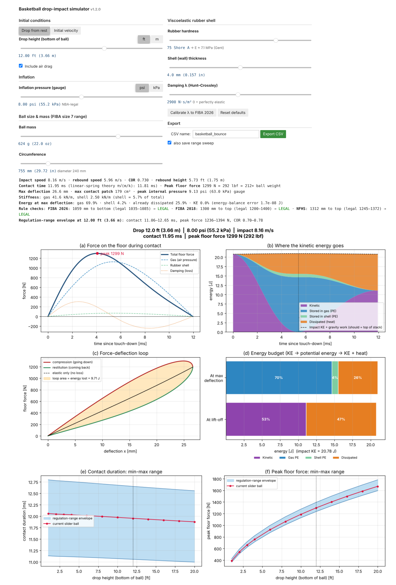
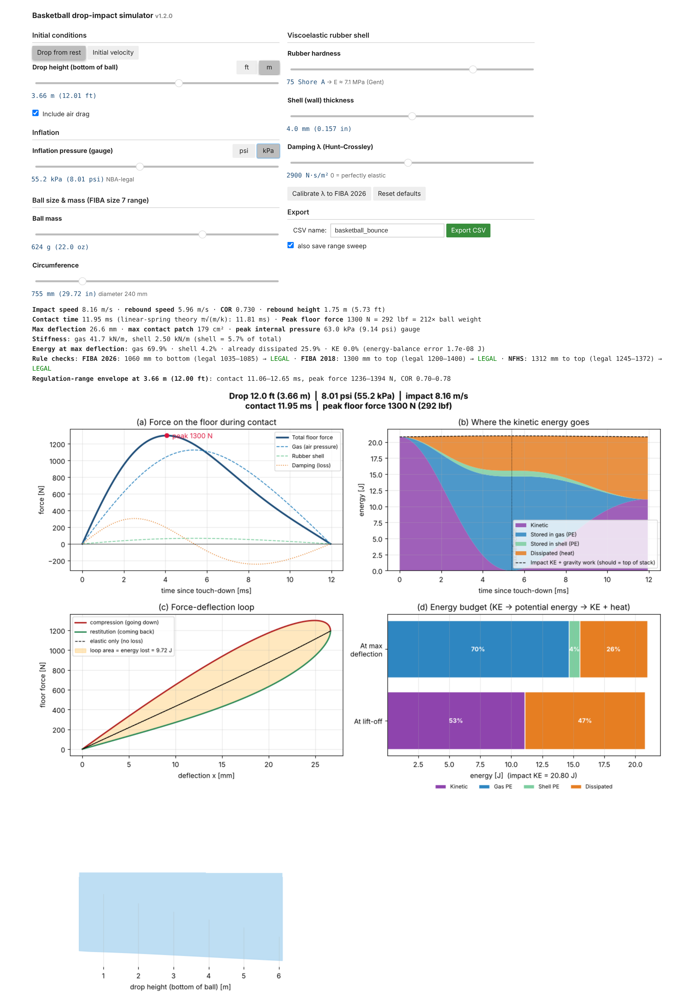
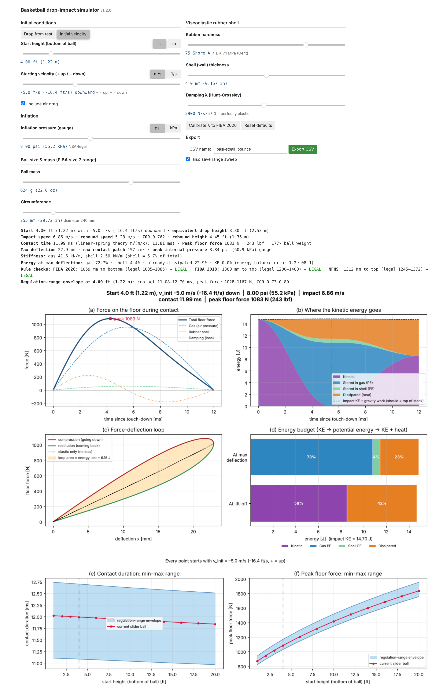
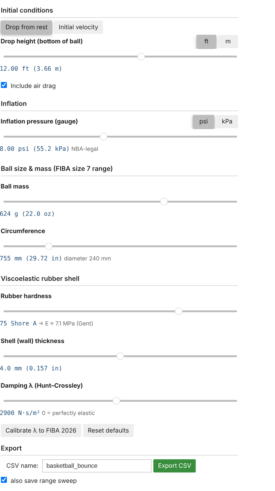
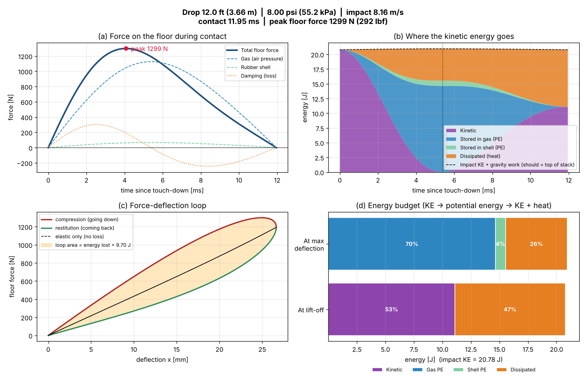
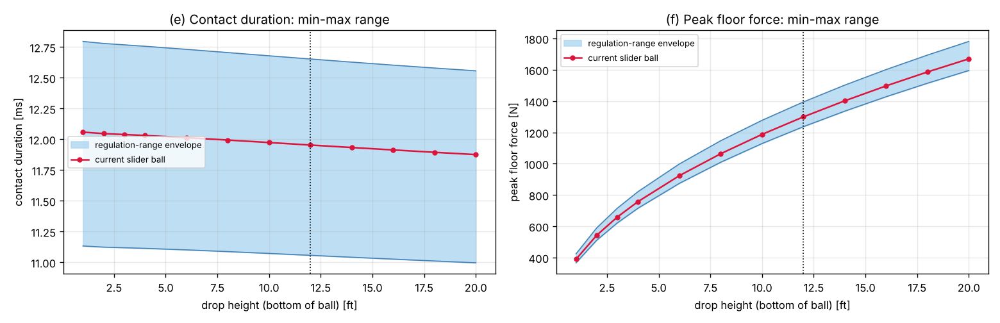

# What the tool looks like

These screenshots come from **version 1.2.0** running in JupyterLab. They show the panel
you will see after running the notebook cell, so you know what to expect before
installing anything.

## Full panel (imperial units)

The panel shows a 12 ft drop of an 8 psi ball, with damping calibrated to the FIBA 2026
rebound test. It has controls, live readouts, the four-panel bounce figure and the
regulation-range envelope.

## Metric units

The same ball with the height toggle set to **m** and the pressure toggle set to **kPa**.

## Initial-velocity mode

Instead of a simple drop, the ball can start with a vertical velocity: **+ up** or
**− down**, in m/s or ft/s. This example throws the ball **down at 5 m/s** from 4 ft.
The panel reports the equivalent drop height, here about 2.5 m (8.3 ft), that would give the same
impact speed.

## Narrow window

When the window is narrow, the two control columns stack. Each slider's current value is
printed **below** the slider, so it is never cut off.

## Example figures

**Example results (12 ft drop, 8 psi):**

* Contact time ≈ 12.0 ms
* Peak floor force ≈ 1300 N (≈ 290 lbf)
* At maximum squash, 70 % of the impact energy is stored in the air, 4 % in the rubber
  shell, and 26 % has already been dissipated
* Across regulation-plausible balls: contact time 11.1–12.7 ms, peak force 1240–1390 N

The example CSV output is in
[`examples/`](https://github.com/ticohannan/basketball-bounce-sim/tree/main/examples).

## Documentation

* [Design document](DESIGN.md): equations, assumptions, verification and validation
* [References](REFERENCES.md): ASME format, with DOIs, ISBNs and URLs
* [User guide plan](USER_GUIDE_PLAN.md)
* [Changelog](https://github.com/ticohannan/basketball-bounce-sim/blob/main/CHANGELOG.md)
* [Source code](https://github.com/ticohannan/basketball-bounce-sim). BSD-3-Clause
  license, © 2026 Tico Hannan.

